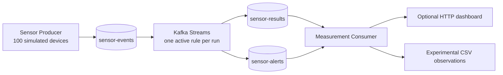

# IoT Sensor Monitoring with Apache Kafka

An end-to-end event streaming application for synthetic IoT temperature measurements, developed as the practical component of the Bachelor thesis **“Technology Analysis: Event Streaming with Apache Kafka”** (B.Sc. Applied Computer Science, Hochschule Mainz, 2026).

The project serves two purposes: it implements a working **sensor-to-monitoring pipeline** with stateless and stateful rules, and it provides a controlled **experimental environment** for evaluating the effects of processing patterns, Kafka configuration, local parallelism, and broker failure on throughput, end-to-end latency, and reliability.

## Motivation

IoT monitoring systems receive continuous measurements and may need to detect abnormal values or changes immediately. Event streaming allows those measurements to be published, processed, and observed without waiting for a batch job. However, the behavior of the pipeline depends not only on application logic but also on Kafka's acknowledgment, replication, and processing configuration.

This implementation makes those effects observable through repeatable synthetic workloads. Its purpose is **not** to provide a production-ready temperature monitoring service or an advanced anomaly detection algorithm; the processing rules are intentionally simple so that architectural and configuration differences can be studied under controlled conditions.

## Architecture



The services are independent applications connected through Kafka topics:

| Component | Responsibility |
| --- | --- |
| **Sensor Producer** | Generates reproducible synthetic temperature events for 100 device IDs, publishes them at a configurable target rate, and records publication attempts and outcomes. |
| **Kafka cluster** | Stores and distributes the events. Docker Compose configurations support one broker or three replicated brokers, with three separate KRaft controllers in both setups. |
| **Kafka Streams service** | Reads sensor events, evaluates one selected rule, produces a result for each processed event, and produces an alert if the rule triggers. |
| **Measurement Consumer** | Observes results and alerts, records arrival timestamps, identifies duplicate result deliveries, and exports result-level observations. |
| **Optional dashboard** | Displays live operational metrics through an HTTP endpoint and browser UI. It is separate from the scientific post-processing scripts. |
| **Experiment coordinator and analysis scripts** | Supervise experimental runs, validate completion evidence, and generate throughput, latency, reliability, and recovery reports. |

The application topics are:

| Topic | Kafka key | Message contents |
| --- | --- | --- |
| `sensor-events` | `deviceId` | `eventId`, `runId`, `deviceId`, `temperature`, `eventTime`, `sentAt` |
| `sensor-results` | `deviceId` | `eventId`, `runId`, `deviceId`, `eventTime`, `sentAt`, `ruleType`, `triggered` |
| `sensor-alerts` | `deviceId` | `eventId`, `runId`, `deviceId`, `eventTime`, `sentAt`, `ruleType` |

Messages use JSON. `eventTime` is the synthetic event timestamp, while `sentAt` records the producer-side wall-clock time at publication. Both are Unix epoch milliseconds. The `runId` and `eventId` support tracing events and distinguishing experiment runs. Using `deviceId` as the Kafka key keeps measurements for the same device ordered within a partition.

## Processing rules

Only **one processing rule is active per Kafka Streams execution**. Each rule emits a `SensorResult` for the processed event; an additional `SensorAlert` is emitted when the rule triggers.

| Rule | Pattern | Condition used in the experiments |
| --- | --- | --- |
| `HIGH_TEMPERATURE` | Stateless | Trigger when the current temperature is **greater than 30 °C**. |
| `HIGH_FREQUENCY` | Stateful | Count measurements per `(runId, deviceId)` in **10-second, event-time, tumbling windows**; trigger when the count **exceeds 20**. |
| `RAPID_CHANGE` | Stateful | Compare consecutive measurements per `(runId, deviceId)`; trigger when the temperature difference is **greater than 5 °C** and the event-time gap is **at most 5 seconds**. |

All thresholds are configurable. The stateful rules use Kafka Streams state stores. The synthetic generator advances event timestamps monotonically for each device, which is an assumption of the stateful processors.

## Technology stack

- **Apache Kafka 4.1.2** and **Kafka Streams 4.1.2**, in KRaft mode
- **Java 21** and **Maven** for the three Java services
- **Python 3** (standard library) for experiment orchestration and scientific result processing
- **Docker Desktop / Docker Compose** with **Ubuntu on WSL2** for the experimental Kafka infrastructure
- **Java HTTP server** and bundled **Chart.js** for the optional dashboard

The thesis experiments were run on a single Windows 11 workstation with an Intel Core i9-12900KS, 64 GB RAM, SSD storage, and WSL2. Performance figures from other machines are not expected to be identical.

## Prerequisites

Use a Linux-compatible shell, preferably **Ubuntu under WSL2**, and install or enable:

- Java Development Kit **21** (`java` and `javac`)
- Maven (`mvn`)
- Python **3** (`python3`)
- Docker and the **Docker Compose v2** plugin (`docker compose`)
- Bash and standard Linux command-line utilities

The Docker engine must be running. For **B3**, additional requirements apply: a working `systemd --user` session, `systemd-run`, and support for CPU, memory, and swap cgroup controls. The original experiment setup ran locally; deployment in a different environment must be validated separately.

Commands below are run **from the repository root**.

## Installation and quick start

### 1. Start the three-broker Kafka cluster

```bash
docker compose -f infra/compose.3-brokers.yml up -d
```

The default experimental topology contains **three brokers and three KRaft controllers**. Its host bootstrap addresses are:

```text
localhost:29092,localhost:39092,localhost:49092
```

Create or verify the three application topics:

```bash
bash infra/create-topics.sh
```

Each topic has **six partitions**, **replication factor 3**, and **`min.insync.replicas=2`**. The topic script verifies existing topics and rejects mismatching configurations rather than changing them silently.

For the **one-broker B2 alternative**, use the separate Compose configuration and topic script instead:

```bash
docker compose -f infra/compose.1-broker.yml up -d
bash infra/create-topics-1-broker.sh
```

In that topology, use `localhost:19092`; topics have six partitions, replication factor 1, and `min.insync.replicas=1`. The two deployments have distinct Compose project names and should not be mixed in the same experiment.

### 2. Compile and test the Java services

```bash
mvn -f services/sensor-producer/pom.xml test
mvn -f services/kafka-streams/pom.xml test
mvn -f services/measurement-consumer/pom.xml test
```

The launcher scripts compile their respective modules automatically for ordinary execution.

### 3. Run a small demonstration

This example runs the `HIGH_TEMPERATURE` rule on the **three-broker** topology. Use three terminals from the repository root. The example uses a dedicated `runId` and output directory; do **not** reuse a historical experiment ID or overwrite an experiment's files.

Prepare a separate directory:

```bash
mkdir -p experiments/demo
```

**Terminal 1 — Measurement Consumer and dashboard:**

```bash
bash scripts/run-measurement-consumer.sh \
  --bootstrap-servers localhost:29092,localhost:39092,localhost:49092 \
  --group-id demo-temperature-consumer \
  --auto-offset-reset latest \
  --run-id demo-temperature-001 \
  --dashboard-port 8080 \
  --result-csv-output experiments/demo/demo-results.csv
```

**Terminal 2 — Kafka Streams:**

```bash
bash scripts/run-kafka-streams.sh \
  --bootstrap-servers localhost:29092,localhost:39092,localhost:49092 \
  --application-id demo-temperature-streams \
  --rule HIGH_TEMPERATURE \
  --temperature-threshold 30
```

**Terminal 3 — Sensor Producer:**

```bash
bash scripts/run-sensor-producer.sh \
  --bootstrap-servers localhost:29092,localhost:39092,localhost:49092 \
  --run-id demo-temperature-001 \
  --random-seed 123 \
  --initial-event-timestamp 1700000000000 \
  --timestamp-increment 1 \
  --target-events-per-second 10 \
  --warm-up-seconds 0 \
  --measurement-seconds 30 \
  --csv-output experiments/demo/demo-producer-totals.csv \
  --event-csv-output experiments/demo/demo-producer-events.csv
```

Open **http://localhost:8080** to view the optional dashboard, or **http://localhost:8080/metrics/dashboard** for its JSON endpoint. Stop the long-running Consumer and Streams applications with `Ctrl+C` after the Producer finishes. The demo is illustrative and is **not** one of the controlled thesis experiments.

For supported CLI parameters, inspect the services' built-in help, for example:

```bash
bash scripts/run-sensor-producer.sh --help
bash scripts/run-kafka-streams.sh --help
bash scripts/run-measurement-consumer.sh --help
python3 scripts/run-experiment.py --help
```

## Experimental evaluation

The thesis investigates four controlled comparisons:

| Scenario | Comparison | Workload |
| --- | --- | --- |
| **B1 — Processing Patterns** | Stateless `HIGH_TEMPERATURE` versus stateful `HIGH_FREQUENCY` and `RAPID_CHANGE`, evaluated separately | LOW: 10, MEDIUM: 100, HIGH: 1,000 requested events/s |
| **B2 — Kafka Configuration** | 1 broker versus 3 brokers, and producer `acks=1` versus `acks=all` (idempotence disabled for this comparison) | LOW and HIGH |
| **B3 — Local Parallelism** | 1 versus 2 Kafka Streams instances, using the same `RAPID_CHANGE` processing rule and the same total resource budget | HIGH |
| **B4 — Broker Failure and Recovery** | Three-broker replicated cluster without failure versus controlled broker stop and restart | MEDIUM |

Each selected condition was executed three times. The thesis reports **63 finalized experimental runs** (B1: 27, B2: 24, B3: 6, B4: 6). The configuration directory also contains pilots and an earlier B4 repetition, which should not be confused with the final set.

Across B1–B3, the ordinary experiment schedule consists of **60 seconds of warm-up**, **300 seconds of measurement**, and a bounded **drain of up to 120 seconds**. B4 uses a separate controlled failure/recovery timeline as specified in its JSON configurations and in the thesis.

The analysis covers:

- Requested and achieved input rates; attempted and confirmed producer throughput
- Unique result throughput
- End-to-end latency, including **P50, P95 and P99**, calculated from `resultReceivedAt - sentAt`
- Duplicate deliveries, missing observed results, and operational/finalization evidence
- For B4, broker leadership, in-sync replicas (ISR), service interruption, and recovery behavior

**Observed missing results are not automatically classified as proven Kafka data loss.** The scripts distinguish recorded absence from conclusions that the available evidence cannot establish.

## Experiment reproduction

Configurations live in `experiments/config/`, including the execution plans and per-run JSON files. The coordinator accepts one JSON configuration at a time:

```bash
python3 scripts/run-experiment.py --config PATH_TO_NEW_EXPERIMENT_CONFIG.json
```

**Do not execute the historical JSON files unchanged.** They reference existing `runId` values and output directories. The coordinator refuses to use an output directory that already exists, preventing accidental replacement of prior run evidence.

For a new run:

1. Start the correct one- or three-broker topology and create/verify its topics.
2. Isolate the run from previous topic data and application state. Read the applicable reset script's `--help` and inspect its effects before using `--execute`: **reset deletes the three application topics and all stored messages**. Never reset an active or valuable cluster.
3. Copy the appropriate configuration to a new JSON file. Assign a **new `runId` and `outputDirectory`**; also update run-specific Consumer group IDs, Streams application IDs, and B3 state directories when applicable. Preserve the chosen experimental condition and its other parameters.
4. For B3, prebuild the Streams classes and runtime dependencies using the command provided by `bash scripts/run-kafka-streams-b3.sh --help`, and verify that the required `systemd-run` resource controls work. For B4, review the target broker, Compose project, control timings, and safety requirements before allowing the coordinator to stop and restart a broker.
5. Run the coordinator with `--config` and inspect the generated evidence. Finalization requires its operational checks; the existence of an output folder alone does not establish a successful experiment.

The coordinator creates a run-specific folder containing evidence such as `run-config.json`, `coordination.jsonl`, component logs, `producer-events.csv`, and `sensor-results.csv`. For a **finalized** run, generate the scientific reports with:

```bash
python3 scripts/generate-results.py \
  --run-config experiments/results/NEW_RUN_ID/run-config.json
```

This creates `throughput.csv` and `summary.json`. The report generator **refuses to overwrite** pre-existing scientific outputs. The coordinator additionally supports an explicit `--revalidate-run` path for eligible blocked runs; it does not launch a new workload.

**Data availability:** The historical raw result directories may occupy several gigabytes and are not automatically included in a source-only clone. Reproducing the experiment procedure requires the code and configurations; independently checking the original thesis measurements additionally requires access to the archived run evidence. Whether those archives are published with the repository must be confirmed separately.

## Repository structure

```text
.
├── README.md
├── docs/
│   └── implementation-decisions.md
├── infra/
│   ├── compose.1-broker.yml
│   ├── compose.3-brokers.yml
│   ├── create-topics*.sh
│   └── reset*.sh
├── services/
│   ├── sensor-producer/
│   ├── kafka-streams/
│   └── measurement-consumer/
├── scripts/
│   ├── run-*.sh
│   ├── run-experiment.py
│   ├── b4-control.py
│   ├── analyze-throughput.py
│   ├── latency_metrics.py
│   ├── reliability_metrics.py
│   ├── generate-results.py
│   └── tests/
└── experiments/
    ├── config/
    └── results/                  # Generated/archived observations
```

## Testing

Java tests are defined separately for each service:

```bash
mvn -f services/sensor-producer/pom.xml test
mvn -f services/kafka-streams/pom.xml test
mvn -f services/measurement-consumer/pom.xml test
```

The experiment coordinator and metric calculators have Python unit tests:

```bash
python3 -m unittest discover -s scripts/tests -p 'test_*.py'
```

These tests are distinct from the controlled Kafka experiments. The above commands are provided for testing; the README does not claim that they were executed successfully on every host environment.

## Thesis

**Bachelor thesis:** *Technology Analysis: Event Streaming with Apache Kafka*

**Institution:** Hochschule Mainz — University of Applied Sciences

**Supervisor:** Prof. Dr.-Ing. Thomas Klauer

**Year:** 2026
